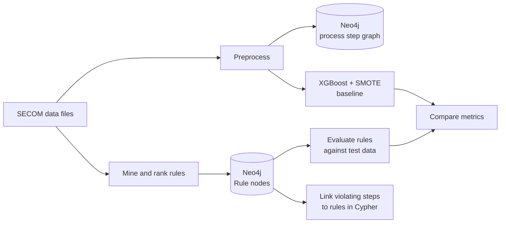
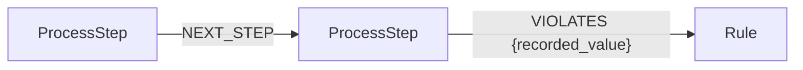

# Ontology-Graph Hybrid for Predictive Maintenance

Failure prediction for semiconductor manufacturing using human-readable rules stored in a Neo4j knowledge graph, benchmarked against an XGBoost classifier on the [UCI SECOM dataset](https://doi.org/10.24432/C54305).

**Stack:** Python, Neo4j, Cypher, OWL, pandas, scikit-learn, XGBoost, imbalanced-learn

## Why this project

A predictive maintenance alert is only useful if an operator can act on it, and that means knowing why it fired. A black-box model on heavily imbalanced data also tends to look accurate while missing most failures.

This project takes a different approach. It mines simple sensor-threshold rules, stores them in a knowledge graph, and links each flagged process step to the rule and sensor reading behind the alert.

## Highlights

- **Knowledge graph:** an OWL ontology and a Neo4j property graph model the production line as a time-ordered chain of process steps.
- **Rule mining:** signal-to-noise filtering and percentile thresholds reduced 590 anonymous sensors to 366 candidate rules, then to the 15 best.
- **Traceable alerts:** a Cypher query connects each flagged step to the rule it violated and records the sensor value.
- **Evaluation:** the rule engine is compared with an XGBoost + SMOTE baseline, then re-tested on a shared test split and without data leakage.

## Dataset

SECOM contains 1,567 production records with 590 anonymous sensor features.

| Property | Value |
| --- | --- |
| Pass / fail records | 1,463 / 104 (about 14:1) |
| Missing values | 41,951 |
| Features after removing constant columns | 478 |

## How it works



### Graph model



| Element | Purpose |
| --- | --- |
| `ProcessStep` | One production record, with its sensor values as properties |
| `FailureEvent` | Extra label on a step: an actual failure after `read_data.py`, or a rule violation after `ingestion.py` |
| `Rule` | Sensor, condition, threshold, precision and support count |
| `NEXT_STEP` | Links each step to the next one in time |
| `VIOLATES` | Links a step to a rule it broke, with the recorded sensor value |

The full load in `read_data.py` creates 1,567 `ProcessStep` nodes, 1,566 `NEXT_STEP` relationships and 104 `FailureEvent` labels. The formal schema is in [`Ontology/fp-1.owl`](Ontology/fp-1.owl).

### Rule mining

The miner works on the raw sensor values and stores its results in Neo4j:

1. **Build failure windows.** For each failure, take the maximum value of every sensor across that step and the 4 before it.
2. **Filter by signal strength.** Calculate `SNR = |mean(fail) - mean(normal)| / std(normal)` and discard sensors below 0.5.
3. **Set a threshold.** Use the 97.5th percentile of the sensor's normal readings, which gives a rule of the form `sensor > threshold`.
4. **Require support.** Keep a rule only if at least 3 failure windows trigger it.
5. **Rank and save.** Sort by `precision × SNR` and store the top 15 as `Rule` nodes.

At prediction time, a step is flagged if **any** rule fires. Its confidence is the highest precision among the rules that fired.

Example rules (precision is measured during mining, on the full dataset):

| Rule | Mining precision | Failure windows matched |
| --- | --- | --- |
| `f_64 > 31.80` | 43.08% | 28 |
| `f_431 > 97.45` | 42.19% | 27 |

## Results

All metrics are for the failure class.

| Model | Evaluation data | Failures in test data | Accuracy | Precision | Recall | F1 |
| --- | --- | --- | --- | --- | --- | --- |
| XGBoost + SMOTE (project run) | Stratified 20% split | 21 of 314 | 92.99% | 0.00% | 0.00% | 0.00% |
| XGBoost + SMOTE (rerun on newer libraries) | Stratified 20% split | 21 of 314 | 93.63% | 66.67% | 9.52% | 16.67% |
| Rule engine (project run) | First 500 rows | 59 of 500 | 75.20% | 22.22% | 44.07% | 29.55% |
| Rule engine | Same stratified 20% split | 21 of 314 | 84.71% | 13.51% | 23.81% | 17.24% |
| Rule engine, no leakage | Last 20% of rows, rules mined on the first 80% | 17 of 314 | 85.03% | 8.33% | 17.65% | 11.32% |

### What the results show

- **Accuracy is misleading here.** XGBoost has the highest accuracy, yet it caught at most 2 of the 21 failures. In the project run it caught none.
- **Rules catch more failures but raise more false alarms.** On the shared split, the rule engine caught 5 of 21 failures with 32 false alarms. The rerun XGBoost model caught 2 with 1 false alarm. Their F1 scores are almost the same, so the rule engine is not a better classifier overall.
- **Mining on the evaluation data inflates scores.** In the first two rule engine rows, the rules were mined from the full dataset, including the rows they were tested on. The last row avoids this and is the best estimate of performance on unseen data: recall of about 18%, at a precision of about 8% against a 5.4% failure rate.
- **The main advantage is explainability.** Every alert points to a specific sensor, threshold and recorded value.

### Limitations

- The test sets contain only 17 to 59 failures, so a few predictions can move the metrics noticeably.
- The sensors are anonymous, so the rules show statistical links and not physical root causes.
- XGBoost's recall changed between library versions, from 0% to 9.52%, so its exact score is not stable.
- Mining precision is optimistic because it compares 5-step failure windows with single normal rows.

### Future work

- Stream sensor data into Neo4j with Apache Kafka to test latency and scalability.
- Apply the method to a dataset with named sensors to support root cause analysis.
- Feed rule matches into a machine learning classifier as features to reduce false alarms.

## Getting started

### Requirements

- Python 3.12 (developed on 3.12.6, with NumPy 1.26.4 and pandas 2.2.3)
- Neo4j Desktop 2.0.5 with Neo4j Database 5.26.0 and the **APOC** plugin
- Windows, because the scripts use Windows-style data paths

```bash
pip install pandas numpy scikit-learn xgboost imbalanced-learn neo4j
```

The scripts connect to `neo4j://127.0.0.1:7687` as user `neo4j` with password `12345678`. To use different credentials, edit the constants at the top of each script.

### Run the pipeline

> [!WARNING]
> `read_data.py` deletes **everything** in the connected database, and `ingestion.py` replaces all `ProcessStep` nodes. Use a dedicated database.

```bash
# 1. Load all records into the graph (must run from Dataset/)
cd Dataset
python read_data.py
cd ..

# 2. Mine rules and save the top 15 to Neo4j
python mining-and-rule.py

# 3. Evaluate the rules
python prediction.py

# 4. Optional: rebuild a smaller demo graph and link violations to rules
python ingestion.py

# 5. Train and evaluate the baseline (does not need Neo4j)
python baseline-xgb.py
```

Step 4 replaces the full graph with the first 500 rows and only the sensors used by the rules. To inspect the alerts afterwards, run this in Neo4j Browser:

```cypher
MATCH (p:ProcessStep)-[v:VIOLATES]->(r:Rule)
RETURN p, v, r
LIMIT 50
```

## Repository structure

| Path | Purpose |
| --- | --- |
| `Dataset/` | SECOM data files and the full graph loader (`read_data.py`) |
| `Ontology/fp-1.owl` | OWL schema for process steps and failure events |
| `preprocess.py` | Zero imputation, constant column removal and min-max scaling |
| `mining-and-rule.py` | Rule mining and ranking, and saving rules to Neo4j |
| `prediction.py` | Evaluates the stored rules on the test split |
| `ingestion.py` | Builds the demo graph and creates `VIOLATES` links |
| `baseline-xgb.py` | XGBoost + SMOTE baseline |

## Authors

Hikmia Sofia Nur Izzati and Audrey Sasqhia Wijaya. Final project at Institut Teknologi Sepuluh Nopember (ITS), 2025.
